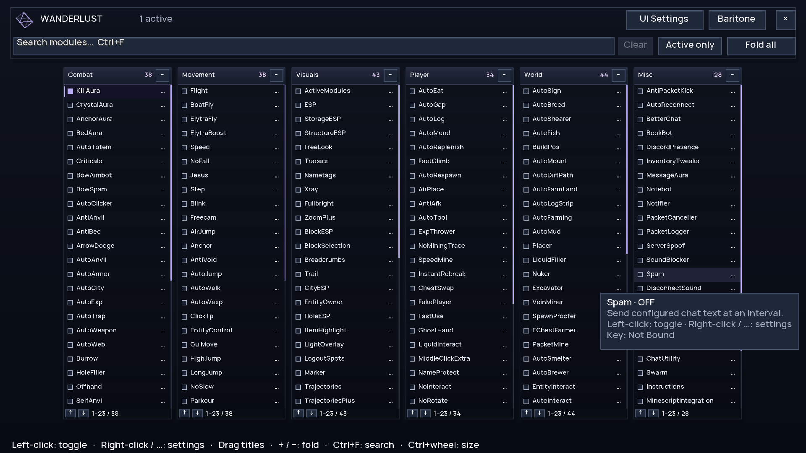
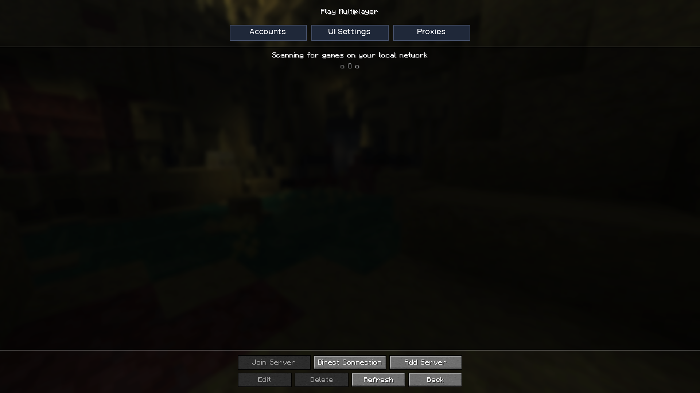
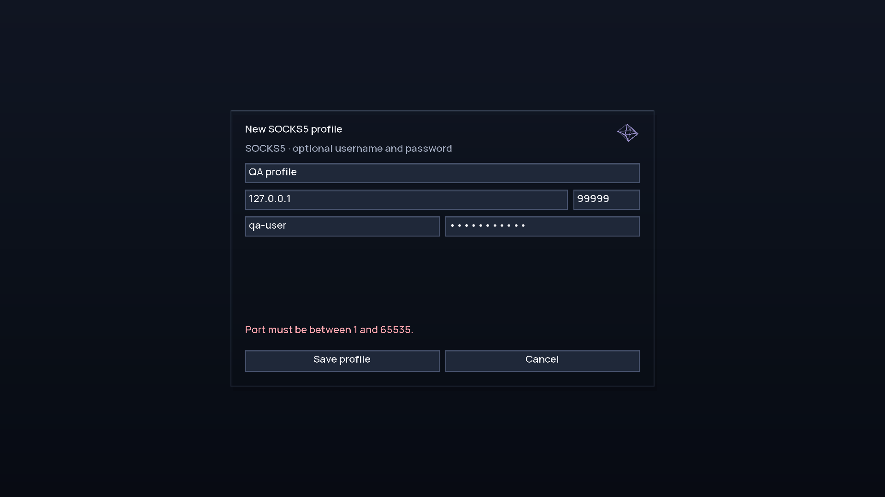
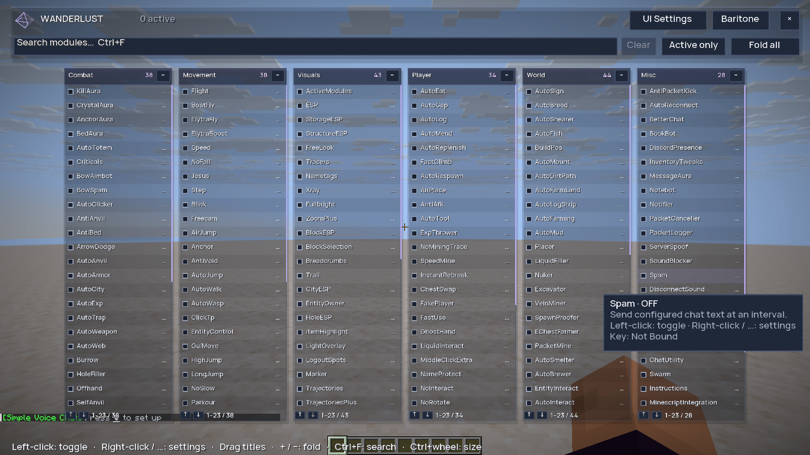

# UI redesign and verification

Verified on 6 November 2026 using Minecraft 26.2, Java 25, Fabric Loader 0.19.5 and Fabric API 0.161.0+26.2. The controlled test instance also contained the installed Baritone, Litematica, MaLiLib and voice-chat mods. Personal accounts, game saves and installed production mods were not changed.

## Design and controls

- Manrope Semibold (weight 600), consistent square controls, graphite surfaces and restrained violet accents.
- Lightweight projected 3D wireframe ornament, staggered panel opening, row fades and eased hover accents. Motion and decoration can be disabled independently.
- 60%, 70% and 85% size presets, continuous size adjustment, Ctrl+wheel resizing and three row-spacing choices. The drag workspace and toolbar stay at native full-screen size.
- Default: 70% module size, 20% panel opacity, Comfortable spacing, automatic fitting and motion enabled. Minimum-layout fitting also prevents categories overlapping when optional fitting is off in very small windows.
- Right Shift opens the module workspace from gameplay, the multiplayer list, world selection and other screens, then restores the originating screen. The key-binding capture dialog deliberately accepts keys as bindings.
- Multiplayer has Accounts, UI Settings and Proxies controls in a reserved header. Account/proxy entry points are confined to multiplayer. The title screen exposes UI Settings directly.
- Accounts, navigation, key binding, entity selection and proxy dialogs share the same styling. Native text editing, keyboard focus and button narration are retained.
- Module help uses client styling; right-click settings, visible ellipsis actions, fold controls, search, tooltips and saved positions remain available.

## Automated checks

`python qa/launch.py --clean --polish` completed **659 checks with zero failures**, and the process exited successfully. The launcher requires the completion marker and rejects assertion failures even if Minecraft exits with code zero.

The matrix covers these physical display sizes at GUI scale 2, with corresponding logical viewport tests:

| Display | Logical viewport |
| --- | --- |
| 640 × 480 | 320 × 240 |
| 800 × 600 | 400 × 300 |
| 1024 × 768 | 512 × 384 |
| 1280 × 720 | 640 × 360 |
| 1280 × 800 | 640 × 400 |
| 1366 × 768 | 683 × 384 |
| 1440 × 900 | 720 × 450 |
| 1600 × 900 | 800 × 450 |
| 1920 × 1080 | 960 × 540 |
| 1920 × 1200 | 960 × 600 |
| 2560 × 1080 | 1280 × 540 |
| 2560 × 1440 | 1280 × 720 |
| 2560 × 1600 | 1280 × 800 |
| 3440 × 1440 | 1720 × 720 |
| 3840 × 2160 | 1920 × 1080 |

For every viewport, category geometry and native controls were checked at 40%, 70% and 100% requested list size, all three densities, and optional fitting both enabled and disabled: **270 module-workspace layouts**. Account, proxy, navigation, entity-picker and UI-settings dialogs were also checked for widget bounds and overlap. Actual rendered captures were inspected at 640×480, 1280×720, 1920×1080 and 3840×2160; the other sizes received geometry checks rather than separate GPU captures.

Interaction checks include actual keyboard-handler routing, restoring menu parents, module left/right clicks, entity filtering/selection, size presets, invalid proxy input, password masking and opening/closing the translucent popup in an integrated world with motion disabled on close.

The local CPU extraction benchmark recorded a median **0.388 ms** and p95 **0.6468 ms** over 60 warmed samples. This measures preparing GUI draw state only; it excludes GPU presentation, world rendering, network stalls and resource loading. It is not an FPS guarantee for other hardware. Filtered module lists and common text components are cached, drag placement uses a bounded candidate search, and the decoration has fixed geometry with no extra world-render or blur pass.

## Proxy scope and checks

SOCKS5 profiles support optional username/password authentication, Direct mode, edits and deletion. Windows DPAPI protects persisted profile data and credentials in a separate vault. Other operating systems use session-only profiles. An unreadable vault is preserved; saving new profiles is blocked until it is repaired or removed. Selecting Direct explicitly permits direct game connections for that session.

Loopback fixtures verified unauthenticated and authenticated byte forwarding, rejected authentication without direct fallback, routing through Minecraft's actual `Connection` mixin, encrypted credential reload, restored active selection, and fail-closed behavior for an unreadable vault. The password field's formatted output was checked independently.

Routing applies to new Minecraft game/status TCP connections. Microsoft authentication HTTP, DNS and independent voice-chat UDP are outside its scope. No external proxy provider or public Minecraft server was used to establish these results.

## Evidence and previews

Full retained assertions: [qa/evidence/ui-polish.txt](qa/evidence/ui-polish.txt). Existing gameplay verification remains separately tracked in [MODULE-AUDIT.md](MODULE-AUDIT.md).

[Minimum-size preview](docs/ui/minimum.png) · [4K preview](docs/ui/4k.png)
